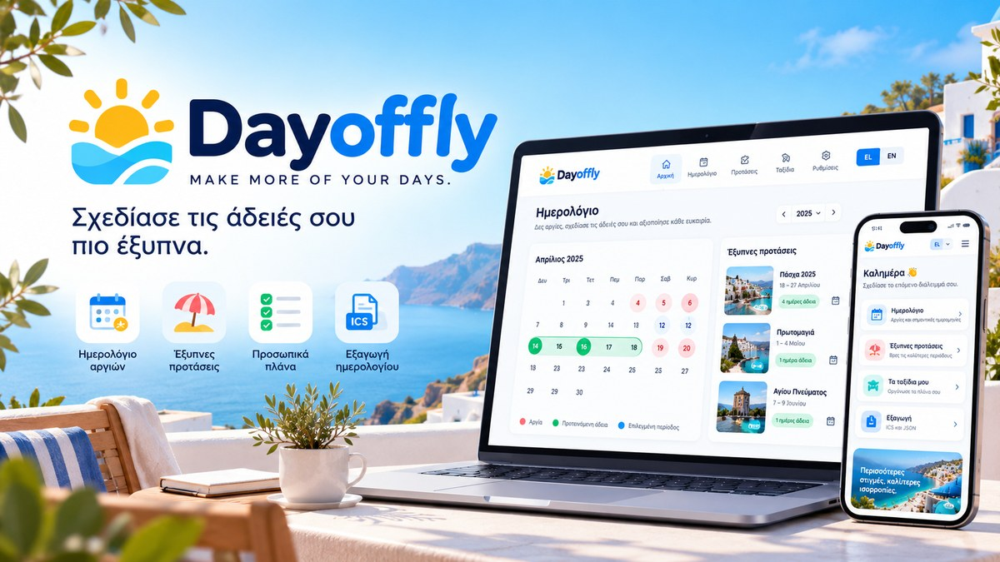

<div align="center">


# Dayoffly ☀️

**Make more of your days.**


A playful, bilingual, mobile-first holiday calendar and smart leave planner.

[**🌐 Open the app**](https://donacgreece.github.io/dayoffly.app/) · [**🐛 Report a problem**](https://github.com/Donacgreece/dayoffly.app/issues)



</div>

## ✨ Why Dayoffly?

Dayoffly helps you turn public holidays and limited leave days into better breaks. Discover long weekends, plan your time off around your working schedule, and keep your plans privately on your device.

## 🧭 Features

| Feature | What's included |
| --- | --- |
| 🌎 Bilingual interface | Greek and English |
| 📅 Holiday calendar | Greek national holidays, movable Orthodox feasts, regional options |
| ✨ Smart leave planner | Recommendations based on working weekdays and available leave days |
| 🗓️ Custom schedules | Choose your regular working weekdays |
| ❤️ Saved plans | Local browser storage, no account required |
| 📤 Export | Download calendar events (ICS) and plan data (JSON) |
| 📱 Responsive design | Desktop, tablet, and mobile layouts |
| 🚀 Installable PWA | Manifest, service worker, and basic offline caching |
| 🔗 GitHub link | Dedicated button in the footer |
| 🖼️ Link preview | 1200 × 675 Open Graph / Twitter image |

## 🛠️ Technology

Vanilla **HTML, CSS, and JavaScript**, with a static GitHub Pages workflow. No backend, API keys, build tool, or user account is required. The UI uses the **Manrope** font, with system-font fallback.

## ▶️ Run locally

Because this is a PWA, use a local HTTP server rather than opening `index.html` directly when testing offline caching. If Python is available:

```powershell
python -m http.server 8080
```

Then visit `http://localhost:8080`.

## 🚢 Publish a release from Windows

1. Download and extract the release ZIP anywhere on your computer.
2. Ensure that Git for Windows is installed and you can push to `Donacgreece/dayoffly.app`.
3. Right-click `Publish-Dayoffly.ps1` and run it through PowerShell, or run the following from **any** working directory:

```powershell
powershell -ExecutionPolicy Bypass -File "C:\Path\To\Dayoffly-v0.0.3\Publish-Dayoffly.ps1"
```

The script clones the repository into a temporary folder, copies release files, creates a commit, and pushes to `main`. It does not require a `.git` folder next to the ZIP. It will never force-push. GitHub Pages can then deploy the new commit automatically using `.github/workflows/pages.yml`.

**Preview:** https://donacgreece.github.io/dayoffly.app/

## 🎨 Brand & design

**Direction:** Playful Lifestyle. A fresh, approachable experience built around an optimistic sky-blue, sunshine-yellow and mint palette. The app uses rounded cards, friendly spacing, and a consistent Greek/English layout.

The social banner is located at `assets/dayoffly-social.jpg`. The Open Graph tags live in `index.html`. When switching from the temporary GitHub Pages URL to a custom domain, update `og:url`, `og:image`, and `twitter:image`.

## 🔐 Privacy & limitations

- Your saved plans and preferences remain in the browser's local storage; there is **no cloud sync**.
- Clearing browser storage deletes locally saved plans. Export important plans first.
- Holiday information and leave calculations are informational, not legal advice or a verified calculation of employment entitlements.
- This release does not include business leave approvals, authentication, or multi-device synchronization.

## 📦 Release history

- **v0.0.3**: Portable Windows publishing, GitHub footer button, social preview metadata and image, polished README.
- **v0.0.2**: Reduced layout movement when switching languages or navigating to short pages; scrollbar stability improvements.
- **v0.0.1**: Initial bilingual holiday planner, leave suggestions, saved plans, and PWA foundation.

## 📄 License

Dayoffly is open source and distributed under the **MIT License**. You can use, modify, redistribute, and build upon the software, including for commercial purposes, provided you retain the original copyright and license notice. See [LICENSE](LICENSE) for the full terms.

Copyright © 2026 Dimitris Galatsanos.

## 🤝 Contributing

Issues and improvement ideas are welcome. Please open a [GitHub issue](https://github.com/Donacgreece/dayoffly.app/issues) before proposing substantial changes.

---

<div align="center"><sub>Made to help you make more of your days. ☀️</sub></div>

## Privacy-first analytics

Dayoffly uses optional Google Analytics 4 (G-V26YX470D6).
The GA4 tag is **not loaded before users accept analytics**.
Users can reject, accept, or revisit their choice through **Analytics settings** in the footer.
Consent preference is stored locally in the browser. No leave dates, saved plans, names, or other personal information are included in custom events.

Events: screen_navigation, language_switch, leave_optimizer_run, leave_plan_save, calendar_export, plan_share, manual_plan_create.

Note: Google Analytics is a third-party service. Before launch, review the privacy notice, cookie/consent obligations for target markets, and analytics settings in Google Analytics.
